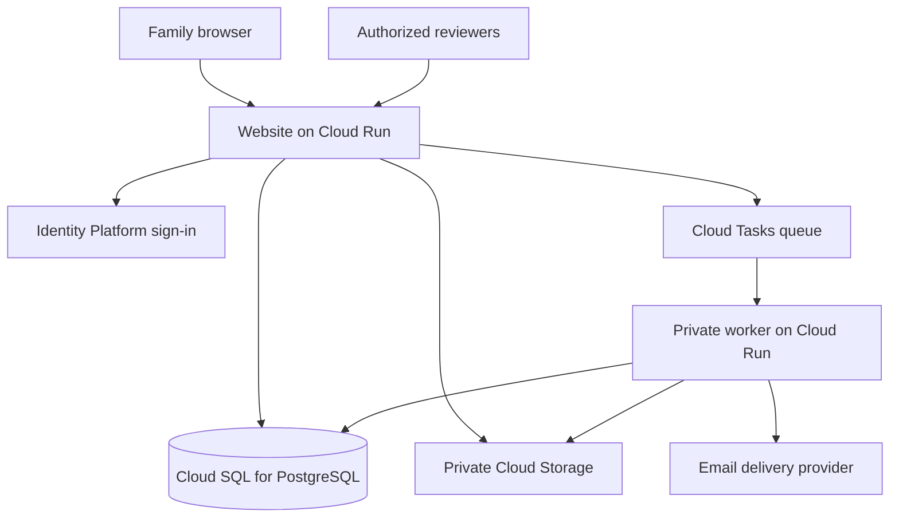

# How to build and run Virtual Cemetery

## Start with one website

Build a mobile-friendly website with **Django** (the software that handles pages, forms, and permission checks) and **PostgreSQL** (the database). Use the same code for the family website, a restricted staff interface, and a background worker. A worker handles jobs such as preparing photos and delivering invitations even after the family closes the browser. One small team can release the system together. The website and worker can each gain capacity independently.



## Software to build and services to use

| Build this software | Use these services | What the service provides |
| --- | --- | --- |
| Family pages, private forms, preview, and staff review screens | Django on Cloud Run | Serves the website and scales the number of running copies. Staff routes require a staff role and multi-factor sign-in. |
| Account linking, family roles, and per-record permissions | Google Cloud Identity Platform + PostgreSQL | Google verifies identity. The app checks what each person may read or change on each request. Begin with verified email sign-in, recovery, and a stronger identity check for high-impact changes such as replacing a steward. |
| Planning, invitations, consent, case decisions, and memorial publishing | Cloud SQL for PostgreSQL | Stores structured records and updates related items together. For example, approving a case and recording the reviewer's decision must succeed together. |
| Photo processing, rights confirmation, and downloads | Private Cloud Storage + background worker | Stores original files privately. Validate file type and size, scan uploads, strip photo location metadata, and create safe display copies. Keep case evidence in a separate private bucket with narrower access and expiration. |
| Invitation delivery, imports, scheduled reminders, and retry handling | Cloud Tasks, Cloud Scheduler when needed, and a transactional email provider such as Postmark | Queues work, limits bursts, and records outcomes. Configure and authenticate the site's sending domain, process bounces, and honor opt-outs. |
| Operations, releases, and recovery | Artifact Registry, Secret Manager, Cloud Logging and Monitoring, Cloud SQL backups | Stores release images and credentials, tracks failures, alerts operators, and supports recovery drills. |

## Keep four kinds of records distinct

| Group | Examples | Who can read them |
| --- | --- | --- |
| Private planning | Wishes, planning answers, contact list, release instructions | The owner and explicitly named recipients, under the owner's timing rules. |
| Verification and permissions | Steward assignments, grants, report evidence, decisions, audit history | Only the people or staff who need that part of the record. A steward can see their assignment status without seeing raw evidence. |
| Published memorial | Approved copy of biography and photos, audience, tributes, accepted relationship links | People within the page and item's allowed audience. Pending notes are visible only to their author and moderators. |
| Operations | Invitations, delivery attempts, payment references, deletion requests | The organizer or operator according to the task. Keep private text, contact lists, access tokens, and evidence out of logs. |

Give people stable internal IDs so a change of name, email, or sign-in provider does not create a second memorial. Store assignments and relationships as rows with both parties, scope, acceptance, and revocation. Publishing creates a **separate approved copy** with references to selected display media. The page renderer reads only from that published set. Changing a plan cannot accidentally publish a new wish. Recheck access on every view, including files, search, background jobs, and exports. A private-page invitation should expire and be redeemed by its intended recipient.

For sensitive documents, serve downloads through an authenticated handler that checks current access. Limit staff access, record case access, and use separate service identities for web requests, evidence review, and background delivery. Apply encryption in transit and at rest. Prevent search indexing and shared caching of restricted pages. Keep public discovery opt-in. Define what gets erased when a user deletes a record, account, or import, including processed images and search entries. Age backups out on a published schedule and reapply deletion records after restoring a backup.

## Connecting other services

| Capability | First implementation | Gate before expanding |
| --- | --- | --- |
| Facebook memories | Let a living owner add a profile link and upload selected photos or stories they own. Then add a guided import from their own downloaded Facebook archive. Preview locally where practical, exclude messages and other people's posts, retain only selected items, and remove any temporary archive. | Treat Facebook Login as an optional sign-in method. Direct import of posts or photos depends on the current Graph API, permissions, and Meta approving this use. Test permitted access with a consenting account and implement disconnect and deletion. A Virtual Cemetery steward has no automatic access to Facebook, and Facebook controls its own memorialization process. |
| Funeral contacts | Start with manual entry and selected CSV/vCard records. Show duplicates and let the organizer correct addresses. | Google People API or Microsoft Graph can support optional address-book selection. Request the least read access, meet consent and verification requirements, and avoid ongoing sync unless the user asks. Importing creates a list. Sending requires a separate confirmation. |
| Nearby providers | Start with a small curated list and official licensing-directory links for the pilot region. | Google Places can return locations, ratings, and review counts. Verify specialty separately. Follow current attribution and storage rules, retain place IDs where permitted, fetch current details, set a request budget, and provide a fallback for sparse results. |
| Site contributions | Use Stripe-hosted Checkout for voluntary site support, subject to country and account eligibility. | Verify signed payment notifications, match amount and currency to the expected contribution, and handle delayed success and refunds. Record one contribution per completed payment. Stripe handles card entry. Any future fundraising for families needs a separate payout and compliance design. |

Provider specifications can change. Check these before promising an integration or committing engineering time. [Meta App Review](https://developers.facebook.com/docs/app-review/) · [Meta permissions](https://developers.facebook.com/docs/permissions/) · [Google People API](https://developers.google.com/people/v1/contacts) · [Microsoft Graph contacts](https://learn.microsoft.com/en-us/graph/api/user-list-contacts?view=graph-rest-1.0) · [Google Places policies](https://developers.google.com/maps/documentation/places/web-service/policies) · [Stripe Checkout fulfillment](https://docs.stripe.com/checkout/fulfillment)

## Organize GitHub

Keep the following in the existing **VirtualCemetery** repository. These are proposed directories for implementation. Only the design documents exist today.

```text
README.md                  Project overview and, later, local setup instructions
docs/                      Requirements, design decisions, and staff procedures
siteapp/                   Website settings and page routing
  accounts/                Identity, roles, and access grants
  planning/                Wishes, contacts, and the planning worksheet
  stewardship/             Steward appointments, reports, decisions, and appeals
  memorials/               Published pages, flowers, notes, and relationships
  events/                  Funeral details, invitations, and delivery records
  integrations/            Email, imports, directory, and payments as added
  templates/               Family and staff screens
  jobs/                    Background work using the same permission rules
tests/                     Automated checks with fictional families
infra/                     Terraform files describing Google Cloud resources
.github/workflows/         Automated tests and deployment instructions
Dockerfile                 Recipe for packaging the app and worker
```

Develop locally with the application, PostgreSQL, a sign-in emulator, and a local email inbox. Use fictional records in development and staging (the private rehearsal site). Keep family documents, cloud credentials, real contact lists, and production database copies out of GitHub. Store production secrets in Secret Manager and restrict access by service.

## From a GitHub change to a live site

1. **Prepare two environments.** Create separate Google Cloud projects for staging and production. Select a region that fits the first families and applicable data requirements. Define the database, buckets, queues, service identities, budgets, and backups in Terraform so a second operator can reproduce them. Keep production access restricted.
2. **Review each change.** A developer opens a pull request, a proposal to merge a change into the main branch. GitHub Actions runs tests for permissions, publishing, job retries, and database changes. A reviewer approves before merge.
3. **Build and rehearse.** On merge, GitHub Actions signs into Google using short-lived credentials through Workload Identity Federation. Build one container image, store it in Artifact Registry, and identify it by its unique digest. Run compatible database migrations once as a Cloud Run Job, deploy that image to the staging web and private worker services, and give only the queue's delivery identity permission to invoke the worker.
4. **Test a family journey.** Create a fictional plan, invite a steward, review a simulated report, publish one selected memory, and deliver one invitation to a test inbox. Check that a private planning item stays inaccessible. Run integration tests with provider sandboxes or test accounts. Keep staging email limited to test recipients.
5. **Release and recover.** A designated approver promotes the same tested image to production. Apply compatible migrations, move traffic gradually, and watch errors and queue delays. Keep the previous working revision available. Database changes need their own recovery plan. Rehearse restoring a backup in an isolated environment.

Deployment references for the builder. [Cloud Run](https://cloud.google.com/run/docs/overview/what-is-cloud-run) · [GitHub Actions authentication on Google Cloud](https://cloud.google.com/iam/docs/workload-identity-federation-with-deployment-pipelines) · [Cloud SQL backup and recovery](https://cloud.google.com/sql/docs/postgres/backup-recovery/backups)

## Growth, reliability, and cost

**Expect bursts around a funeral.** Serve small photo sizes, paginate guestbooks, and index the database fields used to list a memorial's notes and pending invitations. Cloud Run can add web capacity automatically. Set maximum instance counts and database connection limits together so a sudden surge stays within database capacity. Keep slower work in a rate-limited queue.

**Treat each invitation as a one-time action.** Record the approved recipient and event version before queuing. Give that delivery a unique ID. Have the worker recheck cancellation, death status, and recipient eligibility before sending. Use the email provider's duplicate-prevention facility when available. If the provider might have accepted an email before a timeout, reconcile its delivery record before retrying. Apply the same principle to payment events. Alert staff when jobs need attention.

**Measure costs before expanding.** The database has a recurring baseline even on a quiet site. Storage grows with photos and backups. Email, media downloads, maps queries, identity checks, and staff review costs grow with use. Set project budgets and alerts, upload limits, and third-party quotas. Budget alerts send notifications and do not cap spending. Estimate the pilot using expected families, photos, visitors, and messages, then compare the estimate with actual usage. [Google Cloud Pricing Calculator](https://cloud.google.com/products/calculator)

**Expand when a measured limit justifies it.** Use a content delivery network for explicitly public photos once geography or traffic warrants it. Enable regional database high availability according to the agreed outage tolerance, and add read capacity if monitoring identifies sustained read pressure. Track page errors, queue age, delivery failures, database load, backup freshness, and support-case age. Agree with the operator how much downtime and data loss families can tolerate, then time a recovery drill against those targets.

## Suggested build milestones

1. **Family walkthrough.** Test the three-screen prototype in the README. Pick the first jurisdiction, the reviewer, and the support and succession policies.
2. **Invitation-only pilot.** Build the private plan, steward workflow, verification desk, private memorial, guestbook, manual invitations, and export. Release after the permission tests, mistaken-death drill, delivery checks, and backup restore pass.
3. **Family sharing and site support.** Add social archive and contact imports, consensual relationship links, hosted contributions, and optional public discovery. Ship each after its consent, deletion, abuse, and failure paths work.
4. **Professional planning and wider access.** Add the worksheet and regional directory. Obtain legal review for jurisdiction-specific will drafts, and provider approval for any connected-account imports. Open new regions when local rules, moderation, and support are covered.
